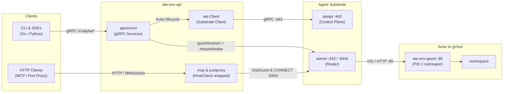
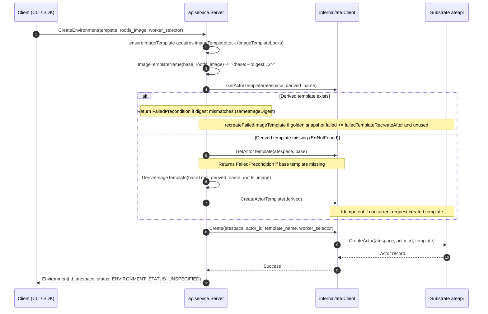
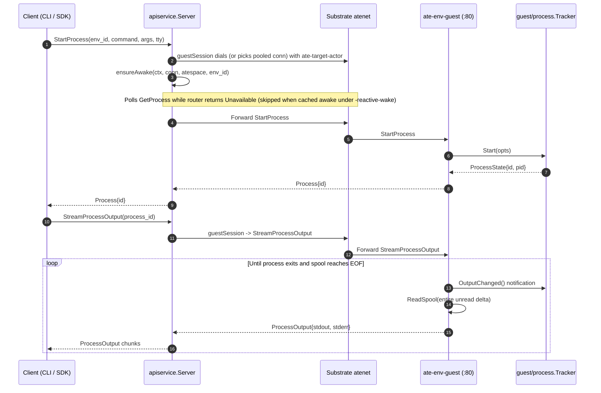

# sandboxenv-rl architecture

Status: describes `main` at `441aa2c9`. Re-check §Components when `internal/ate` or
`internal/apiservice` changes. See [README.md](../README.md) and [docs/glossary.md](./glossary.md).

## Problem

Reinforcement learning rollouts and code-agent evaluations burst hundreds of isolated environments
in parallel, then leave them idle while policies generate tokens. Traditional Kubernetes pods occupy
node memory, IP addresses, and scheduling slots while idle, and rebuilding images per benchmark
duplicates guest binaries in the registry. Agent Substrate runs each environment as a gVisor
(`runsc`) actor that suspends to object storage (`gs://`) when idle, releasing worker memory and
CPU.

## Overview

Clients interact with `ate-env-api` (a cluster Deployment), which translates lifecycle calls to
Substrate (`ateapi`), forwards guest RPCs across `atenet` via `guestSession`, serves MCP tools over
pooled connections, and proxies TCP ports via HTTP `CONNECT` tunnels. Inside each gVisor actor,
`ate-env-guest` runs as PID 1, supervises child processes, and serves `ProcessService` and
`FileSystemService`.

## Components

### `ate-env-api` and `internal/apiservice`

- **Owns**: gRPC API (`EnvironmentService`, `ProcessService`, `FileSystemService`), bearer auth,
  `ActorTemplate` derivation (`imagetemplate.go`), wake retries (`wakeretry.go`), router pooling
  (`-router-pool-size`), `boundedAwakeCache` (`-reactive-wake`), server-span `ate.*` target
  attributes (`span_identity.go`, `-enable-tracing`), `ListPlacementDomains`, and `WarmImage`
  (`-warm-max-probes-per-node`, `placement.go`).
- **Calls**: `internal/ate.Client` (`internal/envstore.Store` under `-environment-store=configmaps`)
  and `atenet` via `s.guestSession` (`routerConns` when pooled).
- **Must not do**: Must not run local commands, buffer full files, or track processes in memory.
  `guestSession` checks `s.ensureAwake` (or `boundedAwakeCache`) and closes unpooled conns.

### Substrate client boundary (`internal/ate` and `internal/routertls`)

- **Owns**: Substrate `ateapi` control-plane calls and pooled guest connections for `internal/mcp`.
- **Calls**: `ateapi` control plane over gRPC (`:443`, round-robin load-balanced) and `atenet`.
- **Must not do**: Must not bypass `internal/routertls` when dialing `atenet`. `internal/routertls`
  loads the kubelet pod-identity cert bundle (`-atenet-client-cert`, 24h lifetime, renewed 30m
  early) and servicedns trust bundle (`-atenet-ca-file`), reloading changed files on TLS handshakes.

### Guest daemon (`cmd/ate-env-guest`, `guest/process`, `guest/filesystem`)

- **Owns**: In-actor execution, process tracking, PTY allocation, file streaming, and sidecars on
  TCP port `80` (HTTP/1.1 and h2c), mounted read-only at `/ate` (`GuestMountPath`).
- **PID 1 init**: As PID 1, `cmd/ate-env-guest/init_linux.go` sets `PR_SET_CHILD_SUBREAPER` and
  re-execs so the outer init reaps orphaned zombies via non-blocking `wait4`.
- **Process tracking**: `guest/process.Tracker` launches non-PTY commands with `Setpgid: true` (PTYs
  with `Setsid: true`) and signals the process group via negative PID (`-pid`). Non-PTY stdout and
  stderr spool to `/var/log/ate-jobs` up to `DefaultMaxLogBytes` (10 MiB/stream), while interactive
  PTY streams spool without a byte limit (`DefaultMaxLogBytes` does not apply).
- **Filesystem**: `guest/filesystem` streams file reads in chunks up to `DefaultReadBufferSize` (64
  KiB). It confines paths to the configured `-workspace` flag root (`guest/filesystem.Service`); the
  default `"/"` disables confinement (`DefaultWorkspace = "/workspace"` and `WORKSPACE` apply only
  in `filesystem.DefaultConfig`, which `cmd/ate-env-guest` bypasses).
- **Sidecars**: `cmd/ate-env-guest/sidecar.go` supervises daemons with restart backoff and `/readyz`
  checks; `internal/sidecarenv` (`Take`) isolates `ATE_SIDECAR_ENV_*` (`-sidecar-env-required`).

### HTTP surfaces on `ate-env-api` (`internal/mcp`, `internal/portproxy`, `internal/hostcheck`)

- **`internal/hostcheck`**: Wraps `/healthz`, `/v1alpha/envs/{id}/mcp`, and the port proxy against
  DNS-rebinding (`WrapFor` restricts port-proxy hostname routes to the proxy); gRPC uses
  `BearerAuth` interceptors.
- **`internal/mcp`**: Serves the Model Context Protocol endpoint at `POST /v1alpha/envs/{id}/mcp`.
  Translates tool calls into guest RPCs using pooled `ate.Client.DialGuest` connections.
- **`internal/portproxy`**: Forwards HTTP/1.1 and WebSocket requests to actor ports via `atenet`
  HTTP `CONNECT` (`:8444`) by header, path, or `-port-proxy-host-suffix`
  (`<port>-<id>[.<atespace>].<domain>`, `internal/portproxy/hostform.go`). Scoped to
  `-port-proxy-atespaces`, pools tunnels, holds `X-Env-Wake-Wait` (`-port-proxy-wake-wait-cap`,
  `DefaultWakeWaitCap` = 1m) on `apiservice.(*Server).Wake`, checks WebSocket capabilities
  (`internal/portproxy/capability.go`) and path/hostname `Origin`, and strips proxy headers.

### CLI, SDKs, and integrations

- **`cmd/ate-env`**: CLI for lifecycle (`create`, `get`, `suspend`, `delete`), inspection and
  warming (`server-info`, `newServerInfoCommand`; `image-status`, `newImageStatusCommand`;
  `placement-domains`, `newPlacementDomainsCommand`; `warm-image`, `newWarmImageCommand`), `shell`,
  `read`/`write`, and `ate-env manifest` (`--domains`, `--node-selector`, `--environment-metadata`,
  `--port-proxy-host-suffix`, `--pod-monitoring`, `template --add-capability`, `workerpool`,
  `reporter`, `collector`).
- **`cmd/ate-env-reporter`**: Daemon (`internal/reporter`) writing cluster fleet inventory snapshots
  (`internal/inventory`) on an interval to a bucket or directory, with optional tick spans
  (`-enable-tracing`) and tick durations (`-metrics-listen-addr`).
- **`cmd/ate-env-fleet-site`**: Read-only IAP Cloud Run server (`internal/fleetsite`, no cluster
  credential) serving Fleet, Cluster, Actor (`/actors/{uid}`), Live (`/live`), and Runs (`/runs`,
  trainer runs and `-bench-buckets`) pages plus `/api/v1/*` JSON and PromQL (`-metrics-project`)
  APIs over bucket snapshots and BigQuery actor events (`-events-table`).
- **`clients/go`**: Public Go SDK (`Client` with `List`, `ClientOptions` with `Connections`,
  `DialOptions`, and `MetricsRegisterer`, `Env`, `Process`, `StartError`).
- **`clients/python`**: `ate-env-rl` (`ate_env_rl`): async `Client` (`credentials`,
  `list_environments`/`EnvironmentPage`), `Env`, `SandboxFleet` (`LoopRunner`), `AsyncSandboxFleet`
  (`recycle`), `wait_pools_ready` (`PoolReadiness`), `release_all`, `teardown(verify=True)`
  (`TeardownReport`), `preflight_report` (`PreflightReport`), `FleetConfig` (`preflight=True`,
  `exit_hooks=True`, `warm_create_budget`), `PreflightWarmer`, `adapters` (`swebench`, `r2egym`).
- **`integrations/e2b`**: In-repo package `ate-env-e2b` (`ate_env_e2b`). Implements E2B's `Sandbox`
  and `AsyncSandbox` over the `envd` runtime layer and port proxy.
- **`integrations/harbor`**: In-repo package `ate-env-harbor`. Implements `AteEnvEnvironment`
  (Harbor 0.25 and 0.26, wrapping commands in `bash -c` when present) and `ate_env_harbor.warm`.
- **`integrations/nemo-gym`**: In-repo package `nemo-gym-substrate`. Implements NeMo Gym's
  `SubstrateSandboxProvider`.
- **`integrations/openhands`**: In-repo package `ate-env-openhands`. Implements OpenHands'
  `AteEnvWorkspace`, `FleetWorkspace`, and `agent_sandbox_rl` (`FleetConfig(preflight=True)`) over
  the port proxy.
- **`integrations/uni-agent`**: In-repo package `uni-agent-substrate`. Implements uni-agent's
  `AteEnvSandbox` (`ate_env` provider) and `r2e_gym` task.

### Benchmarking (`cmd/benchmarking`, `internal/benchmarking`, `benchmarking/`)

- **`cmd/benchmarking/bench`**: RL benchmark CLI (`resolve`, `render`, `prewarm`, `spinup`,
  `spindown`, `measure`, `reap`, `report`, `validate`, `upload`, `compare`, `run`) backed by
  `internal/benchmarking/{job,measure,overlay,schema,sut,swebench}` and `benchmarking/scenarios/`.
- **`cmd/benchmarking/swebench-loader`**: Runs trajectories in `eval`, `steps`, and `open-loop`
  modes (`run`, with `-strategy`, `-placement`, `-domain-width`, `-task-order`, `-preflight` and its
  `-preflight-*` knobs, and `-wake-backoff` across wake and park-suspend retries), resolves
  schedules (`resolve`), renders mixes (`render-plan`, `swebench.BuildRenderedPlan`), plans
  placement (`plan-placement`, `swebench.PlanImagePlacement`), warms caches (`preflight` with
  `-golden`, `swebench.PreflightWarmer`), and handles `trajectory-assets`, `convert-trace`,
  `report`, and `compare`.
- **`internal/benchmarking/swebench`**: Emits JSONL events (`EventRun`, `EventCreate`, `EventTTFI`,
  `EventTTFIC`, `EventWake`, `EventStep`, `EventTask`, `EventFork`, `EventSuspend`, `EventDelete`,
  `EventBarrier`, `EventPark`, `EventPrewarm`, `EventReap`, `EventThink`, `EventPhase`) and
  pre-flight events (`EventPreflightTemplate`, `EventPreflightGolden`, `EventPreflightProbe`).
- **Scripts**: `sample-node-cache.sh` and `harvest-restore-timings.sh` in `benchmarking/swebench/`
  sample containerd image caches and harvest `atelet` restore logs.

## Request flow

### 1. Create an environment with a custom rootfs image

Key non-obvious points:

- `apiservice.(*Server).ensureImageTemplate` holds a per-template read lock, held in this process
  only (`imageTemplateLock` via `imageTemplateLocks` in `internal/apiservice/templaterecover.go`),
  across `CreateEnvironment` actor creation (releasing immediately for `EnsureImageTemplate` and
  `WarmImage`; across replicas, see
  [known limitations](plans/ate-env-api/acceptance-criteria.md#known-limitations)).
  `ensureImageTemplate` also takes the write lock and calls `recreateFailedImageTemplate` when a
  golden bake failed at least `failedTemplateRecreateAfter` (10m) ago, recreating at zero
  `templateUsers`. `GetImageStatus` reads only.
- When the derived template is missing, `getOrCreateImageTemplate` reads the base template, failing
  with `codes.FailedPrecondition` if missing or `codes.InvalidArgument` if `DeriveImageTemplate`
  finds neither free `"guest"`/`GuestMountPath` (`/ate`) (`checkGuestSlotFree`) nor one
  digest-pinned `"guest"` image volume alone at `/ate` with `command[0]` starting the guest
  (`checkGuestMounted`, `checkGuestCommand`). Runtime layers carry over.
- Derived templates running the same digest at another path match (`sameImageDigest`); on mismatch,
  `CreateEnvironment`, `GetImageStatus`, `EnsureImageTemplate`, and `WarmImage` return
  `codes.FailedPrecondition`.
- Optional `worker_selector` labels on `CreateEnvironment` set `Actor.worker_selector` (narrowing
  template worker pools across create and wake), and `GetEnvironment` and `ListEnvironments`
  (`s.client.ListPage`) report `node` (`actorNode`) and `create_time`.
- `ate-env-api` returns `ENVIRONMENT_STATUS_UNSPECIFIED` immediately; actors boot asynchronously.

### 2. Run a command and stream output (including wake-on-request)

Key non-obvious points:

- `s.guestSession` dials (`defer conn.Close()`) or pools `routerConns` (`-router-pool-size`),
  running `ensureAwake` unless in `boundedAwakeCache` (`defaultAwakeCapacity`, `defaultAwakeTTL`,
  `-reactive-wake`). `atenet` wakes actors as `ensureAwake` polls `GetProcess("ate-env-wake-probe")`
  (`DefaultWakeBudget` 5m, `DefaultWakeRunningBudget` 20s `RUNNING`, `DefaultWakeStateReadCap` 5s).
  On `-reactive-wake` `codes.Unavailable`, `boundedAwakeCache` evicts, and idempotent RPCs plus
  `StartProcess` (`x-ate-env-guest-caps: start-request-id`, `StartProcessRequest.request_id`) retry
  once (`SignalProcess` and old-guest `StartProcess` do not; `WriteProcessInput`, `WriteFile`, and
  `Server.Wake` probe).
- `ensureAwake` fails fast on unrecoverable states: `routertls.RejectedCertificate` or `CRASHED`
  returns `codes.FailedPrecondition`, `DELETING` returns `codes.NotFound`, and sustained no-capacity
  responses over a positive `WakeNoCapacityGrace` (`-wake-no-capacity-grace`) return
  `codes.ResourceExhausted`. Crash and no-capacity failures attach trailing metadata
  `StartFailureKey` (`ate-env-start-failure`: `"crashed"` or `"no-capacity"`).

### 3. Suspend and delete an environment

- **Suspend**: `internal/ate.Client.Suspend` calls Substrate with
  `SuspendOptions{Mode: DURABILITY_MODE_SYNCHRONOUS}`, blocking until the checkpoint upload to
  object storage completes. `internal/ate.Client.SuspendLocal` (`SuspendEnvironment` with
  `SUSPEND_MODE_LOCAL`) uses `DURABILITY_MODE_ASYNCHRONOUS`, returning once checkpointed on the
  worker's node while uploading in the background (`ENVIRONMENT_STATUS_PAUSED` until landed). Either
  call leaves an already suspended or paused environment unchanged.
- **Delete**: `internal/ate.Client.Delete` calls `DeleteActor` (stopping any state, releasing
  workers/snapshots) and `evictGuest`, and `s.Store.Delete` removes any `envstore.Record`.

## State and persistence

- **`ate-env-api` keeps no local durable state**: In-memory state is `ate.Client.guestPool`
  (`evictGuest` on `Delete`), `routerConns` (`-router-pool-size`), `boundedAwakeCache`
  (`-reactive-wake`), `mcp.Server`, `imageTemplateLocks`, and `internal/envstore`. Under
  `-environment-store=configmaps` (`-environment-store-qps`, `-environment-store-burst`),
  `internal/envstore` keeps one `ConfigMap` per actor UID (`SweepOrphans`, `ActorUIDs`).
- **Substrate control plane (`ateapi`) is the source of truth**: Stores actor records, templates,
  worker pool allocations, and state transitions in PostgreSQL.
- **Snapshots**: Suspended actors persist memory and filesystem layers in `gs://`. Template golden
  snapshots seed new actors, and per-actor snapshots store multi-step checkpoints.
- **Inside the actor**: `/workspace` edits persist across processes. Non-PTY spools in
  `DefaultLogDir` (`/var/log/ate-jobs`) cap at `DefaultMaxLogBytes` (10 MiB/stream), and
  `guest/process.Tracker` prunes exited records after `DefaultRetentionPeriod` (1h) or past
  `DefaultMaxRetainedProcesses` (100).

## Relationship to Substrate

`sandboxenv-rl` builds on `go.ate.dev/substrate` (`v1.0.0`, `ate.dev/v1` CRDs and
`substrate.ateapi.v1.Control`):

- **Delegated to Substrate**: Sandbox isolation (gVisor `runsc`), worker pod scheduling, durable
  snapshot storage, actor routing (`atenet`), and workload identity certificates.
- **Added by `sandboxenv-rl`**: In-actor process lifecycle, PTY allocation, file streaming,
  on-demand rootfs image template derivation, wake budget retries, MCP server, HTTP/WebSocket port
  proxy, and Python RL rollout scheduling.
- **Operational coupling**: The cluster's `ateworker-gvisor` image must be built from the Substrate
  release commit matching the control plane, and `ate-env-api` requires
  `spiffe://cluster.local/ns/ate-env/sa/ate-env-api` in `atenet`'s ingress allow-list.

## Security

`sandboxenv-rl` defines four trust boundaries:

1. **Client to `ate-env-api`**: `internal/hostcheck` guards browser port-forwarding against DNS
   rebinding on HTTP endpoints (`/healthz`, MCP, port proxy). With `-auth-token-file`, `BearerAuth`
   enforces constant-time bearer token checks on gRPC and HTTP routes (`GET /healthz` exempt).
2. **`ate-env-api` to Substrate control plane**: Authenticated via projected ServiceAccount bearer
   tokens (`-ateapi-token-file`).
3. **`ate-env-api` to actors**: Routed through `atenet` over mTLS using SPIFFE client certificates.
   Inside the actor, `guest/filesystem` confines file operations to the `-workspace` flag root;
   `cmd/ate-env-guest` defaults `-workspace` to `"/"` (no confinement) unless explicitly set.
4. **Snapshot storage**: Governed by bucket IAM, encryption keys, and retention rules.

See [docs/security/threat-model.md](./security/threat-model.md) for threats and accepted risks.

## Design decisions

- **Thin proxy handlers in `internal/apiservice`**: `apiservice` forwards `ProcessService` and
  `FileSystemService` streams directly to `ate-env-guest` over `atenet`, giving identical execution
  behavior across gRPC, CLI, MCP, and the Python SDK.
- **Router dial paths and wake gaps (Position A)**: Three paths dial `atenet`: (1)
  `apiservice.(*Server).guestSession` (`-router-pool-size`, `ensureAwake`/`boundedAwakeCache`, gRPC
  RPCs), (2) `internal/ate.Client.DialGuest` (actor-pooled for `internal/mcp` without `ensureAwake`,
  duplicating `guestSession` interceptors, a known gap), and (3) `internal/portproxy` (`CONNECT`
  wake loop and `X-Env-Wake-Wait` holds).
- **Interceptors append `ate-target-actor` without forwarding caller metadata**: Forwarding caller
  headers duplicated `ate-target-actor: <atespace>/<id>`, which `atenet-router` rejects with
  "invalid actor reference".
- **PID 1 child subreaper re-exec in `cmd/ate-env-guest`**: Re-execs so the outer PID 1 runs
  non-blocking `wait4` reaping for orphans without racing `os/exec.Cmd.Wait` in the process tracker.
- **OCI image volume for guest injection (`/ate`)**: Derived templates mount `ate-env-guest`
  read-only at `/ate`, running unmodified task images without rebuilding images per benchmark.
- **Persistent `LoopRunner` thread for Python sync APIs**: `SubstrateBackendDriver` keeps a shared
  background `asyncio` loop for `SandboxFleet` and `SandboxHandle` via `LoopRunner.run()`, avoiding
  short-lived `asyncio.run()` loops that corrupt HTTP/2 channels.
- **HTTP/2 concurrent stream limit of 4096**: `ate-env-api` sets
  `DefaultMaxConcurrentStreams = 4096` (vs Go's 250 default) and `clients/python` opens
  `ceil(max_concurrent / 200)` connections to prevent stream exhaustion during massive RL rollouts.

See [code layout](./dev/code-layout.md) and [pitfalls](./dev/concurrency-and-pitfalls.md).
