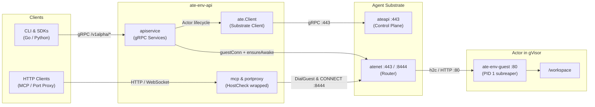
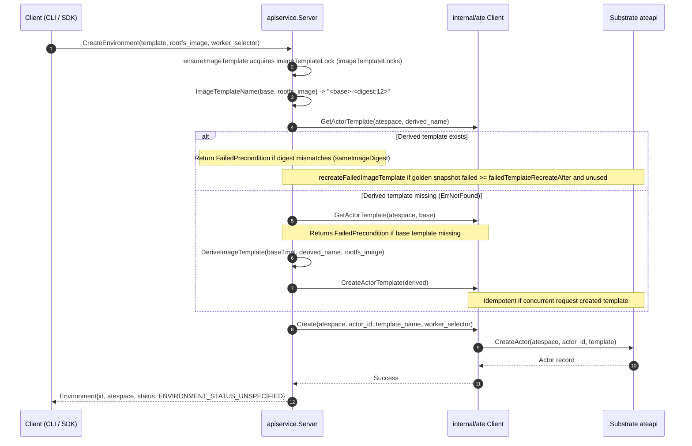
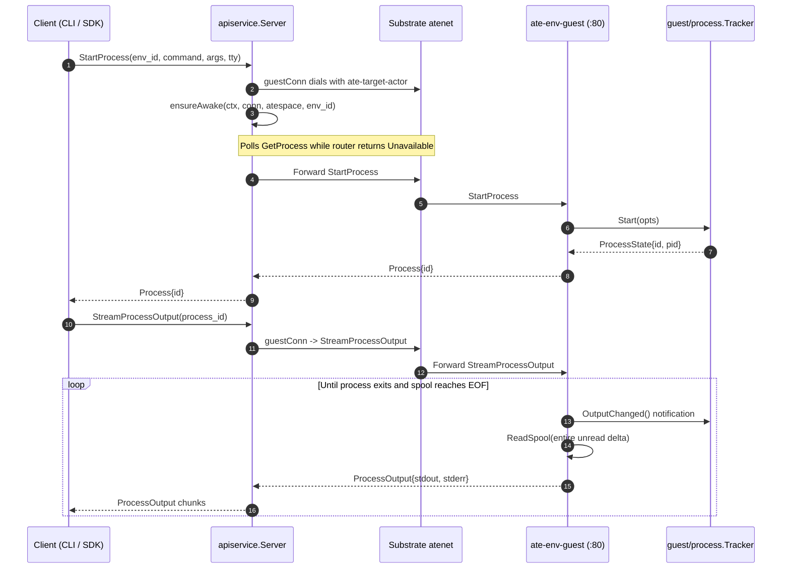

# sandboxenv-rl architecture

Status: describes `main` at `637a24fb`. Re-check §Components when `internal/ate` or
`internal/apiservice` changes. See [README.md](../README.md) and [docs/glossary.md](./glossary.md).

## Problem

Reinforcement learning rollouts and code-agent evaluations burst hundreds of isolated environments
in parallel, then leave them idle while policies generate tokens. Traditional Kubernetes pods occupy
node memory, IP addresses, and scheduling slots while idle, and rebuilding images per benchmark
duplicates guest binaries in the registry. Agent Substrate runs each environment as a gVisor
(`runsc`) actor that suspends to object storage (`gs://`) when idle, releasing worker memory and
CPU.

## Overview

Clients interact with `ate-env-api`, which runs as a Kubernetes Deployment inside the cluster.
`ate-env-api` translates environment lifecycle calls into Substrate control plane requests
(`ateapi`), forwards guest process and filesystem calls across the Substrate router (`atenet`) via
`guestConn`, serves MCP tools over pooled connections, and proxies arbitrary TCP ports via HTTP
`CONNECT` tunnels. Inside each actor, `ate-env-guest` runs as PID 1 in gVisor, spawns supervised
child processes, and serves `ProcessService` and `FileSystemService`.

## Components

### `ate-env-api` and `internal/apiservice`

- **Owns**: In-cluster gRPC API (`EnvironmentService`, `ProcessService`, `FileSystemService`),
  bearer authentication, on-demand `ActorTemplate` derivation (`imagetemplate.go`), wake retries
  (`wakeretry.go`), placement discovery (`ListPlacementDomains`), and node warming (`WarmImage`,
  capped per node of a worker selector by `-warm-max-probes-per-node` via `placement.go`).
- **Calls**: `internal/ate.Client` for lifecycle (and `internal/envstore.Store` under
  `-environment-store=configmaps`), and `atenet` via `s.guestConn` for guest RPCs.
- **Must not do**: Must not execute commands locally, buffer full files in memory, or manage
  in-memory process tracking. `guestConn` opens a connection per call, verifies actor readiness via
  `s.ensureAwake`, and closes the connection on completion.

### Substrate client boundary (`internal/ate` and `internal/routertls`)

- **Owns**: Substrate `ateapi` control-plane calls and pooled guest connections for `internal/mcp`.
- **Calls**: `ateapi` control plane over gRPC (`:443`, round-robin load-balanced) and `atenet`.
- **Must not do**: Must not bypass `internal/routertls` when dialing `atenet`. `internal/routertls`
  loads the kubelet pod-identity cert bundle (`-atenet-client-cert`, 24h lifetime, renewed 30m
  early) and servicedns trust bundle (`-atenet-ca-file`), reloading changed files on TLS handshakes.

### Guest daemon (`cmd/ate-env-guest`, `guest/process`, `guest/filesystem`)

- **Owns**: In-actor execution, process tracking, PTY allocation, file streaming, and sidecar
  supervision on TCP port `80` (plaintext HTTP/1.1 and h2c). Mounted into rootfs images at `/ate`
  (`GuestMountPath`).
- **PID 1 init**: When running as PID 1, `cmd/ate-env-guest/init_linux.go` sets
  `PR_SET_CHILD_SUBREAPER` and re-execs itself. The outer process acts as an init reaper, collecting
  orphaned zombie processes with non-blocking `wait4` calls.
- **Process tracking**: `guest/process.Tracker` launches non-PTY commands with `Setpgid: true` (PTYs
  with `Setsid: true`) and delivers signals to the process group via negative PID (`-pid`). Stdout
  and stderr for non-PTY processes spool to `/var/log/ate-jobs` up to `DefaultMaxLogBytes` (10 MiB)
  per stream; interactive PTY streams spool without a byte limit (`DefaultMaxLogBytes` does not
  apply).
- **Filesystem**: `guest/filesystem` streams file reads in chunks up to `DefaultReadBufferSize` (64
  KiB). It confines paths to the configured `-workspace` flag root (`guest/filesystem.Service`); the
  default `"/"` disables confinement (`DefaultWorkspace = "/workspace"` and `WORKSPACE` apply only
  in `filesystem.DefaultConfig`, which `cmd/ate-env-guest` bypasses).
- **Sidecars**: `cmd/ate-env-guest/sidecar.go` supervises daemons with restart backoff and `/readyz`
  checks; `internal/sidecarenv` (`Take`) isolates `ATE_SIDECAR_ENV_*` (`-sidecar-env-required`).

### HTTP surfaces on `ate-env-api` (`internal/mcp`, `internal/portproxy`, `internal/hostcheck`)

- **`internal/hostcheck`**: Wraps `/healthz`, `/v1alpha/envs/{id}/mcp`, and the port proxy against
  DNS-rebinding (`WrapFor` restricts port-proxy hostname routes to the proxy); gRPC uses
  `BearerAuth` interceptors.
- **`internal/mcp`**: Serves the Model Context Protocol endpoint at `POST /v1alpha/envs/{id}/mcp`.
  Translates tool calls into guest RPCs using pooled `ate.Client.DialGuest` connections.
- **`internal/portproxy`**: Forwards HTTP/1.1 and WebSocket requests to actor ports via `atenet`
  HTTP `CONNECT` (`:8444`) by header, path, or `-port-proxy-host-suffix`
  (`<port>-<id>[.<atespace>].<domain>`, `internal/portproxy/hostform.go`). Scoped to
  `-port-proxy-atespaces`, pools tunnels, holds `X-Env-Wake-Wait` (`-port-proxy-wake-wait-cap`,
  `DefaultWakeWaitCap` = 1m) on `apiservice.(*Server).Wake`, checks WebSocket capabilities
  (`internal/portproxy/capability.go`) and path/hostname `Origin`, and strips proxy headers.

### CLI, SDKs, and integrations

- **`cmd/ate-env`**: CLI for lifecycle (`create`, `get`, `suspend`, `delete`), inspection and
  warming (`server-info`, `newServerInfoCommand`; `image-status`, `newImageStatusCommand`;
  `placement-domains`, `newPlacementDomainsCommand`; `warm-image`, `newWarmImageCommand`), `shell`,
  `read`/`write`, and `ate-env manifest` (`--environment-metadata`, `--port-proxy-host-suffix`,
  `--pod-monitoring`, `template --add-capability`, `reporter`, `collector`).
- **`cmd/ate-env-reporter`**: Daemon (`internal/reporter`) writing cluster fleet inventory snapshots
  (`internal/inventory`) on an interval to a bucket or directory.
- **`cmd/ate-env-fleet-site`**: Read-only web server (`internal/fleetsite`) for Cloud Run behind
  Identity-Aware Proxy: the Fleet and Cluster pages and a JSON API over every cluster's snapshot,
  and actor events from BigQuery. It holds no cluster credential.
- **`clients/go`**: Public Go SDK (`Client` with `List`, `ClientOptions` with `Connections`,
  `DialOptions`, and `MetricsRegisterer`, `Env`, `Process`, `StartError`).
- **`clients/python`**: `ate-env-rl` (`ate_env_rl`): async `Client` (`credentials`,
  `list_environments`/`EnvironmentPage`), `Env`, `SandboxFleet` (`LoopRunner`), `AsyncSandboxFleet`
  (`recycle`), `release_all`, `teardown(verify=True)` (`TeardownReport`), `preflight_report`
  (`PreflightReport`), `FleetConfig` (`preflight=True`, `exit_hooks=True`), `PreflightWarmer`, and
  `adapters` (`swebench`, `r2egym`).
- **`integrations/e2b`**: In-repo package `ate-env-e2b` (`ate_env_e2b`). Implements E2B's `Sandbox`
  and `AsyncSandbox` over the `envd` runtime layer and port proxy.
- **`integrations/harbor`**: In-repo package `ate-env-harbor`. Implements `AteEnvEnvironment`, a
  Harbor environment provider (0.25 and 0.26), and `ate_env_harbor.warm`.
- **`integrations/nemo-gym`**: In-repo package `nemo-gym-substrate`. Implements NeMo Gym's
  `SubstrateSandboxProvider`.
- **`integrations/openhands`**: In-repo package `ate-env-openhands`. Implements OpenHands'
  `AteEnvWorkspace` and `FleetWorkspace` over the port proxy.
- **`integrations/uni-agent`**: In-repo package `uni-agent-substrate`. Implements uni-agent's
  `AteEnvSandbox` (`ate_env` provider) and `r2e_gym` task.

### Benchmarking (`cmd/benchmarking`, `internal/benchmarking`, `benchmarking/`)

- **`cmd/benchmarking/bench`**: RL benchmark CLI (`resolve`, `render`, `prewarm`, `spinup`,
  `spindown`, `measure`, `reap`, `report`, `validate`, `upload`, `compare`, `run`) backed by
  `internal/benchmarking/{job,measure,overlay,schema,sut,swebench}` and `benchmarking/scenarios/`.
- **`cmd/benchmarking/swebench-loader`**: Runs trajectories in `eval`, `steps`, and `open-loop`
  modes (`run`, with `-strategy`, `-placement`, `-domain-width`, `-task-order`, `-preflight`, and
  `-wake-backoff` across wake and park-suspend retries), resolves schedules (`resolve`), renders
  mixes (`render-plan`, `swebench.BuildRenderedPlan`), plans placement (`plan-placement`,
  `swebench.PlanImagePlacement`), warms caches (`preflight`, `swebench.PreflightWarmer`), and
  handles `trajectory-assets`, `convert-trace`, `report`, and `compare`.
- **`internal/benchmarking/swebench`**: Emits JSONL events (`EventRun`, `EventCreate`, `EventTTFI`,
  `EventTTFIC`, `EventWake`, `EventStep`, `EventTask`, `EventFork`, `EventSuspend`, `EventDelete`,
  `EventBarrier`, `EventPark`, `EventPrewarm`, `EventReap`, `EventThink`, `EventPhase`) and
  pre-flight events (`EventPreflightTemplate`, `EventPreflightGolden`, `EventPreflightProbe`).
- **Scripts**: `sample-node-cache.sh` and `harvest-restore-timings.sh` in `benchmarking/swebench/`
  sample containerd image caches and harvest `atelet` restore logs.

## Request flow

### 1. Create an environment with a custom rootfs image

Key non-obvious points:

- `apiservice.(*Server).ensureImageTemplate` holds a per-template read lock, held in this process
  only (`imageTemplateLock` via `imageTemplateLocks` in `internal/apiservice/templaterecover.go`),
  across `CreateEnvironment` actor creation (releasing immediately for `EnsureImageTemplate` and
  `WarmImage`; across replicas, see
  [known limitations](plans/ate-env-api/acceptance-criteria.md#known-limitations)).
  `ensureImageTemplate` also takes the write lock and calls `recreateFailedImageTemplate` when a
  golden bake failed at least `failedTemplateRecreateAfter` (10m) ago, recreating at zero
  `templateUsers`. `GetImageStatus` reads only.
- When the derived template is missing, `getOrCreateImageTemplate` reads the base template, failing
  with `codes.FailedPrecondition` if missing or `codes.InvalidArgument` if `DeriveImageTemplate`
  finds neither free `"guest"`/`GuestMountPath` (`/ate`) (`checkGuestSlotFree`) nor one
  digest-pinned `"guest"` image volume alone at `/ate` with `command[0]` starting the guest
  (`checkGuestMounted`, `checkGuestCommand`). Runtime layers carry over.
- Derived templates running the same digest at another path match (`sameImageDigest`); on mismatch,
  `CreateEnvironment`, `GetImageStatus`, `EnsureImageTemplate`, and `WarmImage` return
  `codes.FailedPrecondition`.
- Optional `worker_selector` labels on `CreateEnvironment` set `Actor.worker_selector` (narrowing
  template worker pools across create and wake), and `GetEnvironment` and `ListEnvironments`
  (`s.client.ListPage`) report `node` (`actorNode`) and `create_time`.
- `ate-env-api` returns `ENVIRONMENT_STATUS_UNSPECIFIED` immediately; actors boot asynchronously.

### 2. Run a command and stream output (including wake-on-request)

Key non-obvious points:

- `s.guestConn` opens a connection per request and runs `ensureAwake`. If suspended, `atenet`
  traffic starts restoration; `ensureAwake` polls `GetProcess("ate-env-wake-probe")` across
  `DefaultWakeBudget` (5m whole wait), `DefaultWakeRunningBudget` (20s once `RUNNING`), and
  `DefaultWakeStateReadCap` (5s per state read).
- `ensureAwake` fails fast on unrecoverable states: `routertls.RejectedCertificate` or `CRASHED`
  returns `codes.FailedPrecondition`, `DELETING` returns `codes.NotFound`, and sustained no-capacity
  responses over a positive `WakeNoCapacityGrace` (`-wake-no-capacity-grace`) return
  `codes.ResourceExhausted`. Crash and no-capacity failures attach trailing metadata
  `StartFailureKey` (`ate-env-start-failure`: `"crashed"` or `"no-capacity"`).
- The connection closes with `defer conn.Close()` when the RPC completes.

### 3. Suspend and delete an environment

- **Suspend**: `internal/ate.Client.Suspend` calls Substrate's control plane with
  `SuspendOptions{Mode: DURABILITY_MODE_SYNCHRONOUS}`. This blocks until the memory and filesystem
  checkpoint upload to object storage completes. `internal/ate.Client.SuspendLocal`
  (`SuspendEnvironment` with `SUSPEND_MODE_LOCAL`) uses `DURABILITY_MODE_ASYNCHRONOUS`: it returns
  once the checkpoint is on the worker's node, the upload goes on in the background, and the
  environment reports `ENVIRONMENT_STATUS_PAUSED` until it lands. Either call leaves an environment
  that is already suspended or paused as it is.
- **Delete**: `internal/ate.Client.Delete` calls `DeleteActor` (stopping any state, releasing
  workers/snapshots) and `evictGuest`, and `s.Store.Delete` removes any `envstore.Record`.

## State and persistence

- **`ate-env-api` keeps no local durable state**: In-memory state is `ate.Client.guestPool` (evicted
  on `Delete` via `evictGuest`), `mcp.Server`, `imageTemplateLocks`, and the `internal/envstore`
  informer; streams reconnect on restart. With `-environment-store=configmaps`
  (`-environment-store-qps`, `-environment-store-burst`), `internal/envstore` stores one `ConfigMap`
  per labeled/deadlined environment (by actor UID) and runs `SweepOrphans` (`ActorUIDs`).
- **Substrate control plane (`ateapi`) is the source of truth**: Stores actor records, templates,
  worker pool allocations, and state transitions in PostgreSQL.
- **Snapshots**: Suspended actors persist memory pages and filesystem layers in object storage
  (`gs://`). Template golden snapshots seed new actors. Per-actor snapshots store checkpoints during
  multi-step runs.
- **Inside the actor**: File modifications persist in `/workspace` across process executions. Spool
  files live in `DefaultLogDir` (`/var/log/ate-jobs`) and are capped at `DefaultMaxLogBytes` (10 MB
  per stream for non-PTY commands). `guest/process.Tracker` prunes finished process records after
  `DefaultRetentionPeriod` (1 hour) or when history exceeds `DefaultMaxRetainedProcesses` (100).

## Relationship to Substrate

`sandboxenv-rl` builds on `go.ate.dev/substrate` (`v1.0.0`, `ate.dev/v1` CRDs and
`substrate.ateapi.v1.Control`):

- **Delegated to Substrate**: Sandbox isolation (gVisor `runsc`), worker pod scheduling, durable
  snapshot storage, actor routing (`atenet`), and workload identity certificates.
- **Added by `sandboxenv-rl`**: In-actor process lifecycle, PTY allocation, file streaming,
  on-demand rootfs image template derivation, wake budget retries, MCP server, HTTP/WebSocket port
  proxy, and Python RL rollout scheduling.
- **Operational coupling**: The worker image (`ateworker-gvisor`) running on the cluster must be
  built from the exact Substrate release commit matching the control plane. `ate-env-api` requires
  `spiffe://cluster.local/ns/ate-env/sa/ate-env-api` in `atenet`'s ingress allow-list.

## Security

`sandboxenv-rl` defines four trust boundaries:

1. **Client to `ate-env-api`**: `internal/hostcheck` protects local browser port-forwarding against
   DNS rebinding across HTTP endpoints (`/healthz`, MCP, port proxy). When `-auth-token-file` is
   configured, `BearerAuth` enforces constant-time bearer token validation on gRPC services and
   authenticated HTTP routes (`GET /healthz` is exempt from auth).
2. **`ate-env-api` to Substrate control plane**: Authenticated using optional Kubernetes
   ServiceAccount projected bearer tokens (`-ateapi-token-file`).
3. **`ate-env-api` to actors**: Routed through `atenet` over mTLS using SPIFFE client certificates.
   Inside the actor, `guest/filesystem` confines file operations to the `-workspace` flag root;
   `cmd/ate-env-guest` defaults `-workspace` to `"/"` (no confinement) unless explicitly set.
4. **Snapshot storage**: Governed by bucket IAM, encryption keys, and retention rules.

See [docs/security/threat-model.md](./security/threat-model.md) for the threat analysis and accepted
risks.

## Design decisions

- **Thin proxy handlers in `internal/apiservice`**: `apiservice` forwards `ProcessService` and
  `FileSystemService` streams directly to `ate-env-guest` over `atenet`. Keeping execution logic
  inside the guest ensures identical behavior whether invoked via gRPC, CLI, MCP, or Python SDK.
- **Router dial paths and wake gaps (Position A)**: Three paths dial `atenet`: (1)
  `apiservice.(*Server).guestConn` (ephemeral per call with `ensureAwake`; required for new gRPC
  proxy RPCs); (2) `internal/ate.Client.DialGuest` (pooled per actor, duplicates interceptor logic
  from `guestConn`, and is used only by `internal/mcp` without `ensureAwake`, a known gap); (3)
  `internal/portproxy` (`CONNECT` tunnels with its own wake loop and `X-Env-Wake-Wait` holds).
- **Interceptors append `ate-target-actor` without forwarding caller metadata**: Forwarding incoming
  headers caused duplicate `ate-target-actor: <atespace>/<id>` headers, which `atenet-router`
  rejects with "invalid actor reference".
- **PID 1 child subreaper re-exec in `cmd/ate-env-guest`**: Re-execs so the outer PID 1 runs
  non-blocking `wait4` reaping for orphans without racing `os/exec.Cmd.Wait` in the process tracker.
- **OCI image volume for guest injection (`/ate`)**: Derived templates mount `ate-env-guest`
  read-only at `/ate`, running unmodified task images without rebuilding images per benchmark.
- **Persistent `LoopRunner` thread for Python sync APIs**: `SubstrateBackendDriver` keeps a shared
  background `asyncio` loop for `SandboxFleet` and `SandboxHandle` via `LoopRunner.run()`, avoiding
  short-lived `asyncio.run()` loops that corrupt HTTP/2 channels.
- **HTTP/2 concurrent stream limit of 4096**: `ate-env-api` sets
  `DefaultMaxConcurrentStreams = 4096` (vs Go's 250 default) and `clients/python` opens
  `ceil(max_concurrent / 200)` connections to prevent stream exhaustion during massive RL rollouts.

See [docs/dev/code-layout.md](./dev/code-layout.md) and
[docs/dev/concurrency-and-pitfalls.md](./dev/concurrency-and-pitfalls.md).
